# 디자인 벤치마크: 모바일 여행 서비스 UX 레퍼런스

## 목적과 범위

- 머물전남.의 탐색·축제·장소·보관함·코스 편집·공유 화면을 설계할 때 참고할 실제 서비스 화면과 패턴을 모은 내부 자료다.
- 스크린샷은 **내부 참고용**이다. 제품·마케팅·스토어 자료에 넣지 않는다. 화면과 이미지의 권리는 각 서비스와 원저작자에게 있다.
- 캡처 조건: 2026-10-17, gstack 헤드리스 브라우저, iPhone Safari UA, 뷰포트 390x844 @2x. `wanderlog-desktop-split.png` 한 장만 1280x800 @1x 데스크톱이다. 용량을 줄이려고 256색 PNG로 압축했다(사진에 약간의 색 띠가 보일 수 있다).
- 로그인·가입·폼 제출 없이 공개 페이지만 열었다. 광고·앱 유도 팝업은 "닫기"만 눌렀다.
- 본문의 크기(px)·비율 수치는 캡처를 보고 잰 근사값이다. 그대로 복제하지 말고 우리 토큰 스케일에 맞춰 쓴다.

| 서비스 | 캡처 수 | 주로 본 것 |
|---|---|---|
| 트리플 | 4 | 공개 일정(보기 전용·복사), 타임라인 레일, 장소 상세·영업시간 확인일 |
| 마이리얼트립 | 3 | 국내 탭·지역 전환·칩, 랭킹 리스트, 빈 결과, 진입 광고 시트 |
| 원더로그 | 5 | 일차 날짜 칩, 구간(leg) 행, 지도 전환, 요일별 휴무 표시, 데스크톱 분할 |
| 에어비앤비 | 3 | 칩 필터, 지도+바텀시트, 상세 하단 고정 CTA |
| 대한민국 구석구석 | 4 | 축제 카드·상태 배지, 월 달력, 상세 정보 행 |
| 남도여행길잡이 | 3 | 월별 축제, 시군 라벨, 데이터 누락 처리, 통합특별시 공지 |
| 네이버 플레이스 | 3 | 영업 상태 요약, 요일별 영업·브레이크타임·라스트오더 |

> 참고 맥락: 남도여행길잡이 진입 공지와 네이버 주소 표기에서 2026-07-01 "전남광주통합특별시" 출범이 확인된다. 주소가 "전남광주 여수시 …", "전남광주통합특별시 나주시 …" 형태로 바뀌었고, 남도여행길잡이는 관광 서비스를 "임시 관광누리집"으로 옮기는 중이라고 안내한다. 주소 표기·시군 필터 이름·데이터 출처 링크에 영향이 있는지 기획 쪽 확인이 필요하다(이 문서는 결정하지 않는다).

---

## 1. 트리플 (Triple)

- URL: https://triple.guide (공개 일정 `trips/plan/...?is_public=true`, 맛집 상세 `restaurants/...`)
- 캡처: 공개 일정 첫 화면, 스크롤한 타임라인, 장소 상세, 영업시간 블록

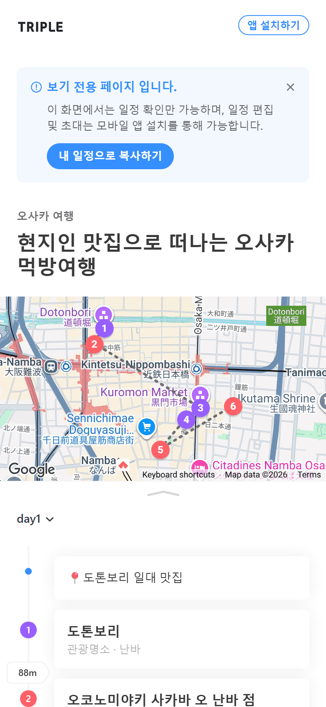
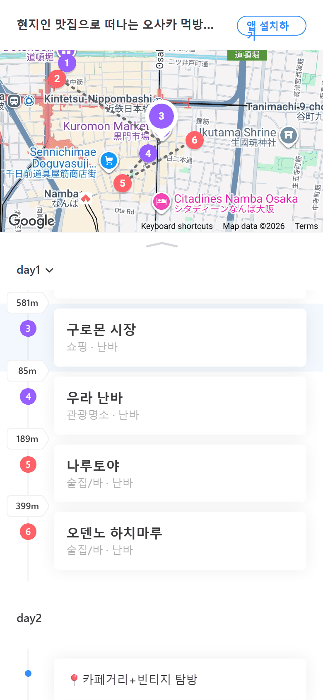
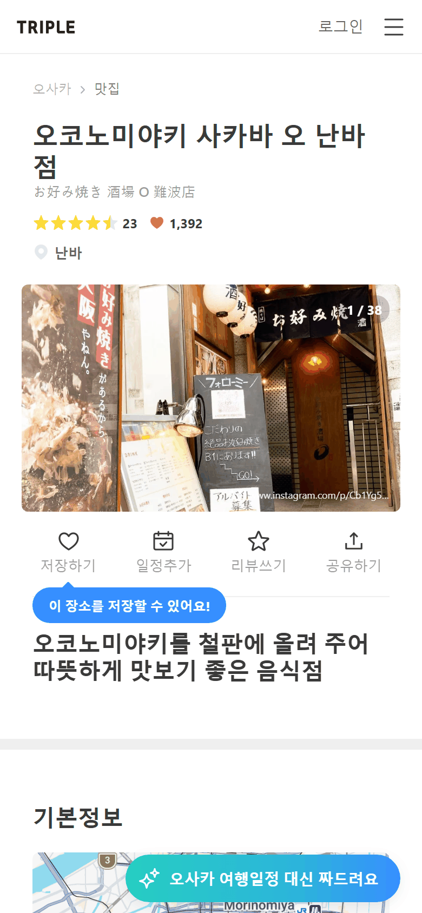
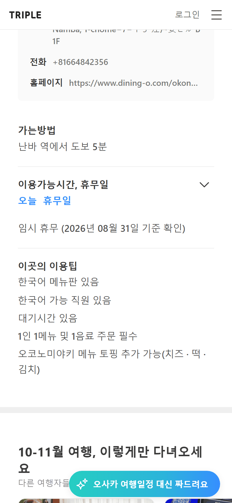

**가져올 패턴**

- **보기 전용 안내 + 복사 단일 CTA**: 공개 일정 최상단에 연한 파란 박스로 "보기 전용 페이지입니다"와 이유 1줄, 그 안에 "내 일정으로 복사하기" 버튼 하나만 둔다. S12 공개 코스, S08 크리에이터 코스의 구조와 거의 같다.
- **지도 + 일차 목록 세로 배치, 스크롤 연동**: 지도가 위, 일차 목록이 아래. 스크롤하면 제목이 헤더로 줄어들고 지도는 상단에 붙는다. 지금 보고 있는 장소 카드는 배경이 옅게 칠해지고 지도 핀이 커진다.
- **타임라인 레일**: 왼쪽 세로선 위에 번호 원(분류별 색), 번호 사이 레일에 "88m" 같은 구간 말풍선이 붙는다. 카드는 장소명(굵게) + "분류 · 동네" 회색 1줄뿐이라 길게 이어져도 읽힌다.
- **일차 테마 줄**: 각 일차 첫 줄에 "도톤보리 일대 맛집" 같은 메모를 카드처럼 둬서 그날의 성격을 먼저 보여준다.
- **장소 상세 구조**: 브레드크럼(오사카 > 맛집), 제목, 별점·저장 수, 사진(약 5:3, "1 / 38" 카운터, 사진마다 출처 URL 표기), 아이콘+라벨 4분할 액션(저장하기·일정추가·리뷰쓰기·공유하기).
- **영업시간 확인일**: "이용가능시간, 휴무일" 접이식 행이 접힌 상태에서도 "오늘 휴무일"을 강조색으로 요약하고, 아래에 "임시 휴무 (2026년 08월 31일 기준 확인)"처럼 기준일을 붙인다. S05의 "최종 확인일" 표기의 직접 레퍼런스다.

**피할 것**

- 스크롤 후 헤더의 "앱 설치하기" 버튼 라벨이 좁은 폭에서 두 줄로 깨진다(타임라인 캡처 우상단). 버튼 라벨은 한 줄로 고정하고 자리가 모자라면 줄인다.
- 상세 하단의 플로팅 "여행일정 대신 짜드려요" 배너가 본문 정보 위에 계속 떠 있다.

## 2. 마이리얼트립 (MyRealTrip)

- URL: https://www.myrealtrip.com (국내 탭 `?isDomestic=true`, 검색 `search`)
- 캡처: 진입 직후 광고 시트, 국내 홈, 검색 빈 결과

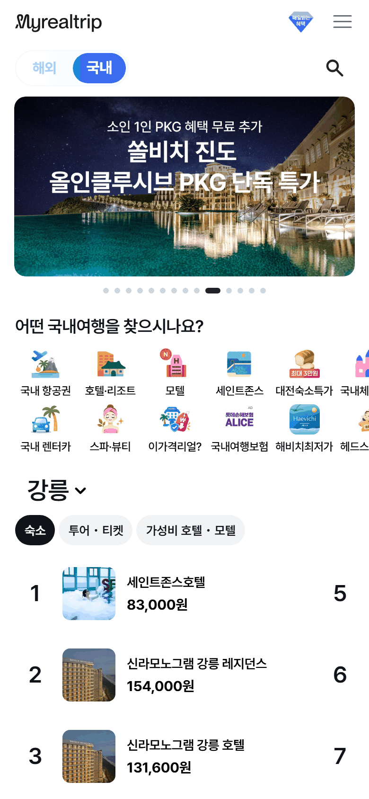
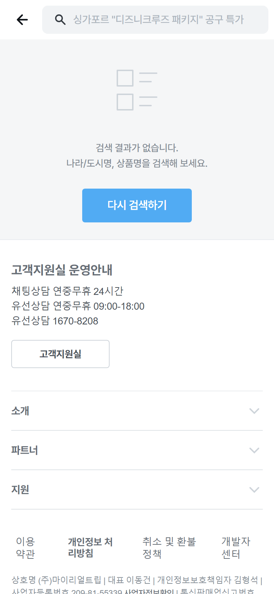

**가져올 패턴**

- **세그먼트 토글**: 헤더 바로 아래 "해외 / 국내" pill 토글. 선택된 쪽만 채운다.
- **제목형 지역 선택 + 카테고리 칩**: "강릉 ⌄"처럼 지역명을 섹션 제목으로 크게 쓰고 누르면 바뀐다. 바로 아래 칩(숙소·투어/티켓·가성비 호텔)으로 종류를 고른다. S01 탐색 홈의 지역 전환에 맞는다.
- **랭킹 리스트 행**: 순번 + 정사각 썸네일(약 56px, 둥근 모서리) + 제목 1줄 말줄임 + 가격 굵게. 행 높이가 일정해서 훑어보기 쉽다.
- **아이콘 퀵메뉴**: 2행 가로 스크롤 아이콘 그리드로 진입점을 모은다.
- **빈 결과 구성**: 아이콘 + 안내 2줄 + 버튼 하나("다시 검색하기").

**피할 것**

- 진입하자마자 화면 2/3를 덮는 광고 바텀시트(20장 캐러셀) + "1일간 보지 않기". 첫 화면에서 서비스 가치를 볼 수 없다. 기획서도 반복 팝업을 금지한다.
- 빈 결과 문구가 무엇이 없었는지 말하지 않는다. 검색창에는 광고 문구가 placeholder로 남아 있어 사용자가 어떤 조건으로 찾았는지 알 수 없다.

## 3. 원더로그 (Wanderlog)

- URL: https://wanderlog.com (공유 가이드 `view/.../shared`, 지도 `.../shared/map`)
- 캡처: 랜딩의 앱 화면 목업, 앱 유도 시트, 일차 목록, 지도 모드, 데스크톱 분할

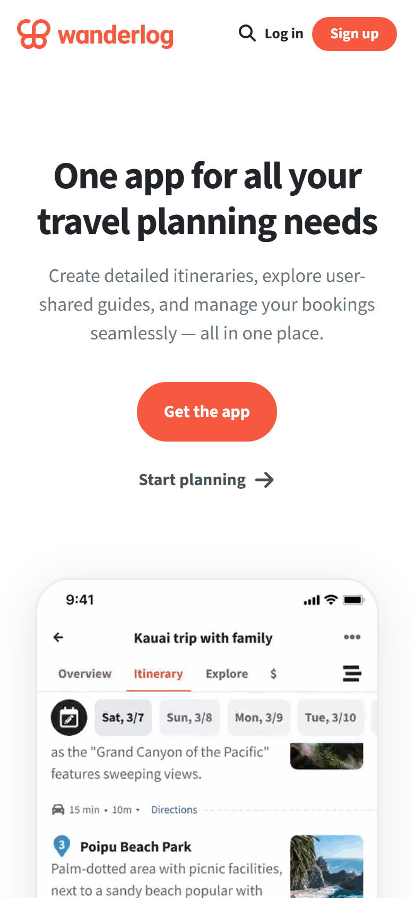
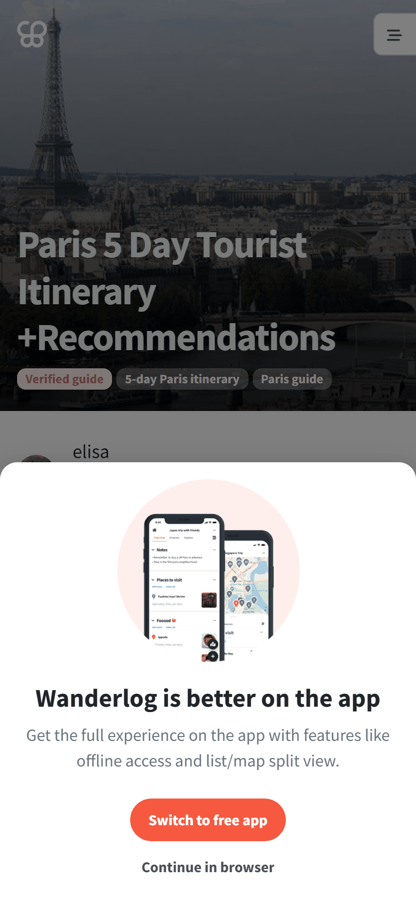
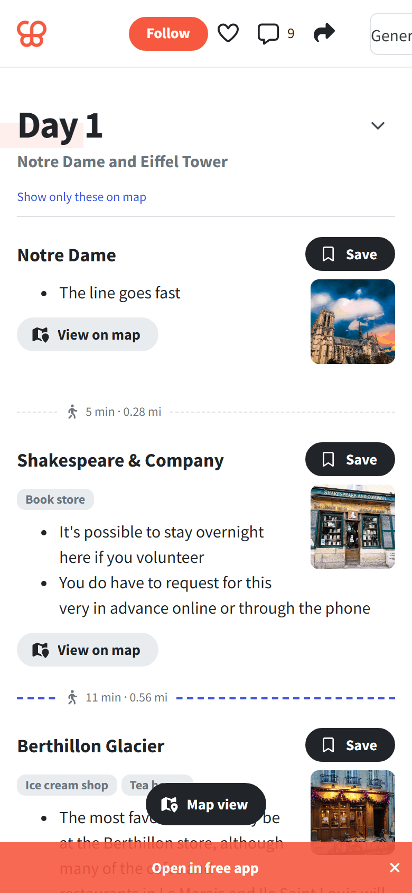
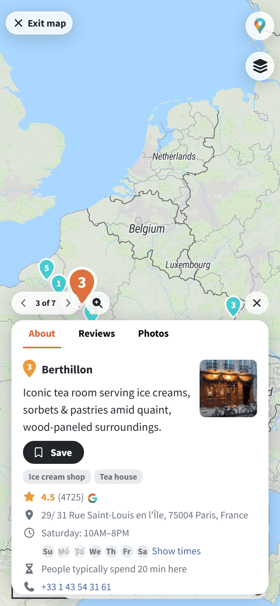
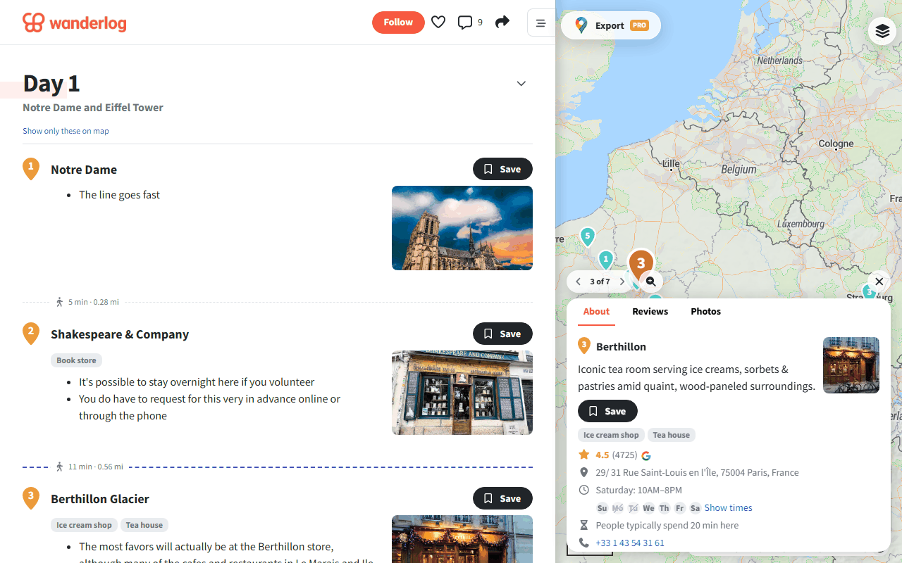

**가져올 패턴**

- **날짜를 붙인 일차 탭**: 편집기 목업 상단에 "Overview / Itinerary / Explore" 탭, 그 아래 "Sat, 3/7 · Sun, 3/8 …" 날짜 칩 가로 스크롤, 맨 앞에 캘린더 아이콘 버튼. 일차 번호만이 아니라 날짜와 요일을 같이 보여준다.
- **구간(leg) 행**: 장소 카드 사이에 점선 + 이동수단 아이콘 + "15 min · 10m · Directions". 카드가 아니라 얇은 행이어서 시간표 흐름이 끊기지 않는다. 목업은 자동차 아이콘을 쓴다.
- **장소 카드 구성**: 왼쪽 번호 핀, 장소명, 분류 칩, 메모 bullet, 오른쪽 정사각 썸네일(약 80px), "View on map" 보조 버튼.
- **목록/지도 전환**: 모바일 하단 중앙 플로팅 필 "Map view". 지도 모드는 좌상단 "Exit map", 하단 장소 카드 시트에 "3 of 7" 이전/다음 페이저.
- **요일별 휴무 칩**: 지도 카드에 "Saturday: 10AM-8PM"으로 오늘 시간 1줄, 아래 요일 칩(Su Mo Tu …)에서 휴무 요일에 취소선. "People typically spend 20 min here"로 체류 시간 근거도 보여준다.
- **데스크톱 분할**: 왼쪽 일정 목록(약 60%) + 오른쪽 지도, 선택한 장소 카드가 지도 위에 뜬다.

**피할 것**

- 앱 유도 바텀시트, 하단 고정 "Open in free app" 배너, 플로팅 "Map view"가 겹쳐 본문 하단이 가려진다.
- 캡처 시점에 지도 기본 범위가 선택 일차가 아니라 대륙 단위로 잡혀 핀이 한쪽에 몰렸다. 우리는 선택 일차의 장소 경계에 맞춘다.
- 공유 가이드의 구간은 도보 기준이다. 우리는 자동차 경로만 쓰므로 아이콘·문구를 그대로 가져오지 않는다.

## 4. 에어비앤비 (Airbnb)

- URL: https://www.airbnb.co.kr (홈, 검색 `s/여수시/homes`, 숙소 상세 `rooms/...`)
- 캡처: 홈, 검색 결과(지도 + 바텀시트), 숙소 상세

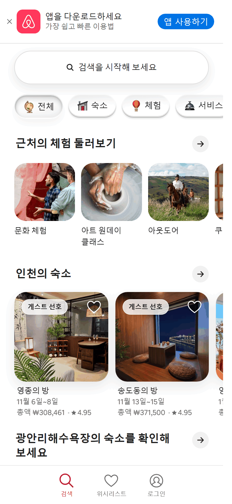
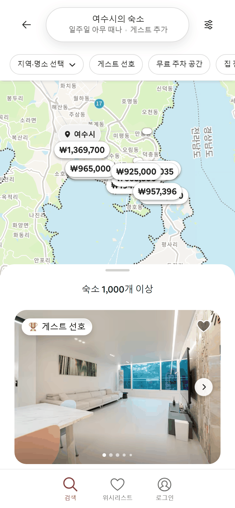
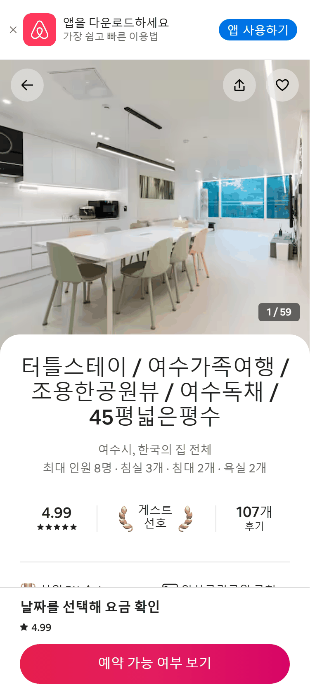

**가져올 패턴**

- **검색 pill + 아이콘 칩**: 큰 둥근 검색 입력 하나, 아래 아이콘+라벨 칩(전체·숙소·체험·서비스). 선택 칩만 그림자로 띄운다.
- **peek 캐러셀**: 가로 카드가 오른쪽 끝에서 잘려 보여 스크롤할 수 있다는 걸 알린다. 카드는 사진(큰 라운드) 좌상단 배지, 우상단 하트 오버레이, 아래 제목·날짜·가격/평점 3줄.
- **하단 탭바 3개**: 검색·위시리스트·로그인. 활성 탭만 브랜드색.
- **검색 결과 화면**: 상단 조건 요약 pill("여수시의 숙소 / 일주일 아무 때나 · 게스트 추가") + 필터 버튼, 가로 칩 필터(지역·명소 선택 ⌄, 무료 주차 공간 …), 지도 위 드래그 바텀시트(핸들 + "숙소 1,000개 이상").
- **상세 화면**: 사진 풀블리드(약 4:3) 위에 반투명 원형 아이콘 버튼(뒤로·공유·저장), "1 / 59" 카운터, 본문 시트가 사진 위로 둥글게 겹친다. 핵심 지표 3개를 세로 구분선으로 나눈 한 줄, 하단 고정 CTA 바(요약 텍스트 + 주 버튼).

**피할 것**

- 지도 가격 핀이 서로 겹쳐 숫자를 읽을 수 없다. 우리 핀은 번호만 쓰고 겹치면 묶는다.
- 상단 앱 다운로드 배너와 앱 유도 시트가 중복으로 뜬다.

## 5. 대한민국 구석구석 (축제)

- URL: https://korean.visitkorea.or.kr/kfes/ (전국축제 `list/wntyFstvlList.do`, 축제달력 `list/festivalCalendar.do`, 상세 `detail/fstvlDetail.do`)
- 캡처: 축제 카드 그리드, 월 달력, 상세 첫 화면, 상세 정보 블록

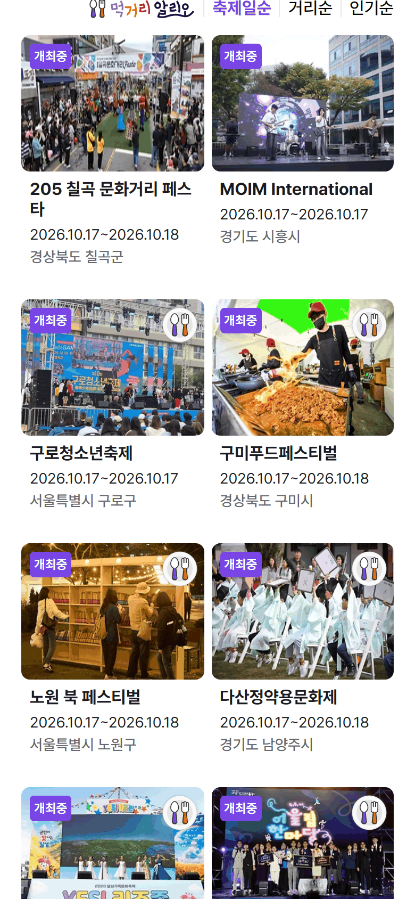
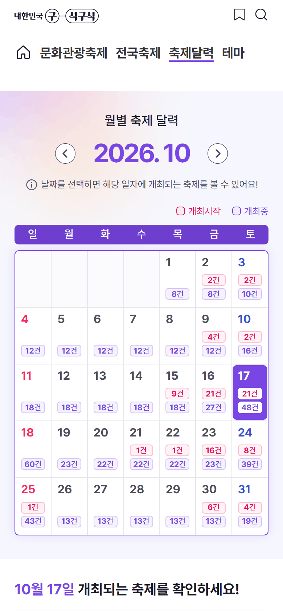

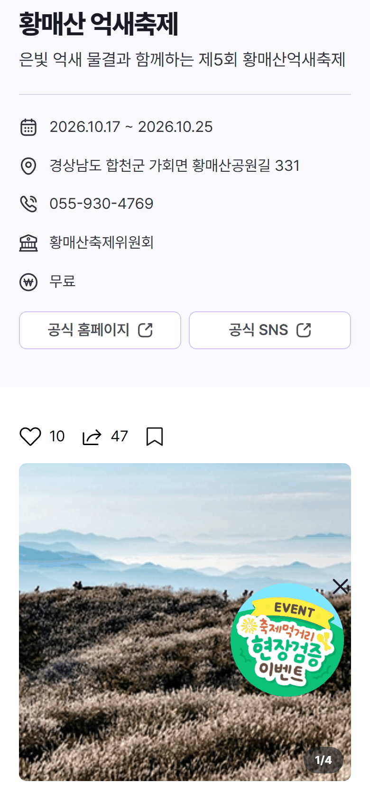

**가져올 패턴**

- **축제 카드 2열 그리드**: 사진(약 4:3) 좌상단 상태 배지 "개최중", 제목 최대 2줄, 기간 "2026.10.17~2026.10.18", 지역 회색. 위에 정렬 탭 "축제일순 / 거리순 / 인기순".
- **월 달력**: 좌우 화살표 + 큰 "2026.10", 범례(개최시작·개최중), 날짜 칸마다 건수 배지, 오늘 칸은 채워서 강조, 일요일 빨강·토요일 파랑. 날짜를 누르면 아래에 "10월 17일 개최되는 축제" 목록이 바로 이어진다. S02 달력 보기의 기본 골격으로 쓸 만하다.
- **아이콘 정보 행**: 기간·주소·전화·주최·요금을 라벨 없이 아이콘 + 값으로 나열하고, 아래 외부 링크 버튼 2개(공식 홈페이지 ↗, 공식 SNS ↗)를 반반 배치.
- **상태 칩**: 상세 제목 위에 "축제 진행 중" 칩과 기온 칩.

**피할 것**

- 세로 포스터를 상세 첫 화면에 꽉 채워 제목·기간·상태가 스크롤 아래로 밀린다.
- 우하단 원형 이벤트 스티커가 기온 칩과 본문을 가린다.
- 목록 최상단 필터가 세로로 쌓인 드롭다운 3개(시기·지역·카테고리) + 버튼 2개라 첫 화면 절반을 차지한다(별도 캡처 없음).

## 6. 남도여행길잡이 (전남 관광 공식)

- URL: https://www.namdokorea.com (축제정보 `tour/fastival/fastivalIndex.do`, 상세 `fastivalView.do`)
- 캡처: 진입 공지 모달, 월별 축제 목록, 축제 상세

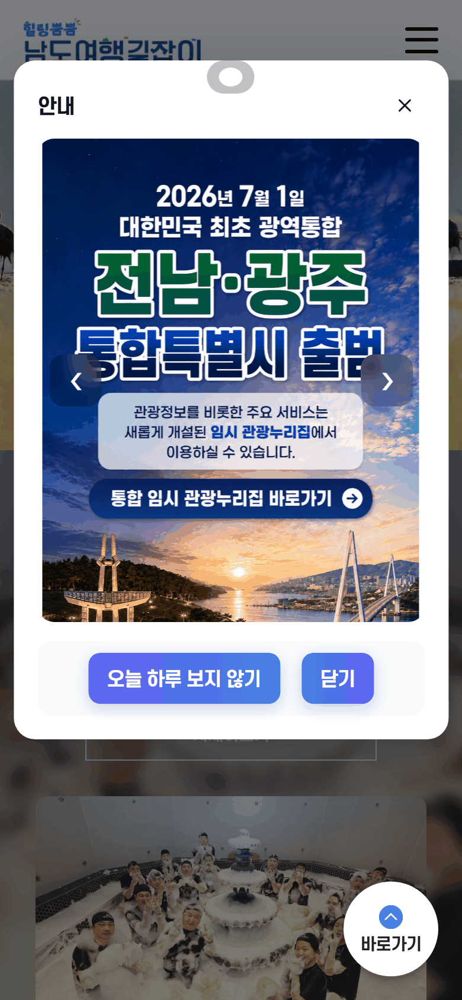
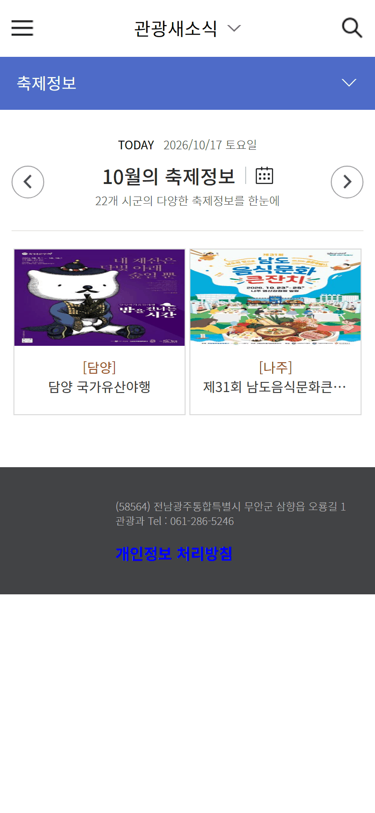
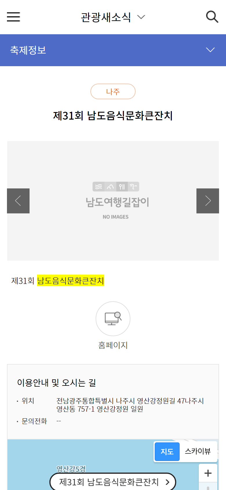

**가져올 패턴**

- **오늘 기준 월 이동**: "TODAY 2026/10/17 토요일" 아래 "10월의 축제정보" + 좌우 화살표 + 캘린더 아이콘. "22개 시군"을 부제로 보여준다.
- **[시군] 라벨**: 카드 제목 위에 "[담양]", 상세 상단에 "나주" pill. 시군 필터와 같은 단어를 카드에도 써서 지역 인식이 빠르다.
- **지도 마커 라벨**: 상세 하단 지도에 축제명 라벨 + ">"로 지도 앱 연결.

**피할 것**

- 축제 카드에 기간이 없고 제목이 1줄에서 잘린다. 상세에도 기간이 첫 화면에 없다.
- 이미지가 없을 때 "NO IMAGES" 자리표시자에 캐러셀 화살표까지 그대로 보인다.
- 값이 없는 필드를 "문의전화 --"처럼 노출한다.
- 진입 공지 모달이 첫 화면을 덮는다(내용 자체는 중요한 공지).

## 7. 네이버 플레이스 (Naver Place)

- URL: https://m.place.naver.com (검색 진입 https://m.search.naver.com)
- 캡처: 통합검색 플레이스 목록, 장소 상세 첫 화면, 펼친 요일별 영업시간

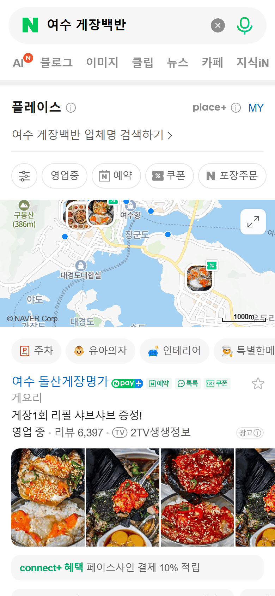

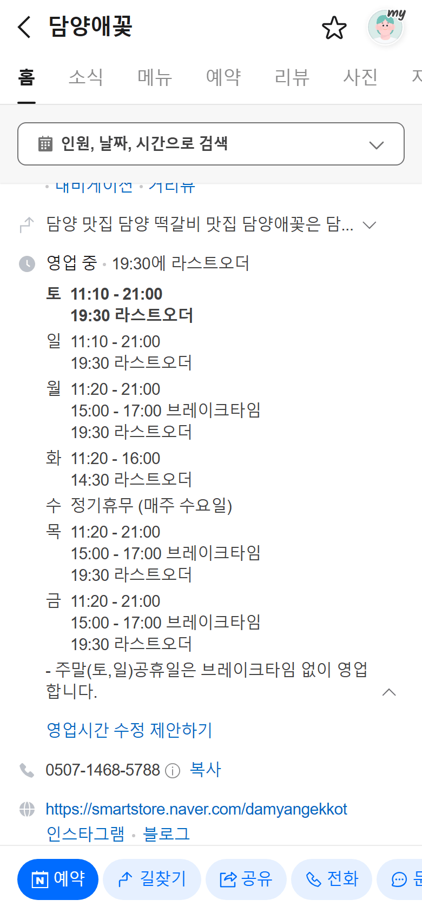

**가져올 패턴**

- **"영업중" 필터 칩**: 검색 결과 상단 칩 줄 첫머리에 "영업중". 카드 메타에도 "영업 중 · 리뷰 6,397".
- **상태 + 다음 전환 시각 요약**: 상세 제목 아래 "게요리 · ★4.66 · 리뷰 2.9만", 다음 줄 "**영업 중** · 20:00에 라스트오더". 상태는 굵게, 다음에 무슨 일이 언제 일어나는지를 붙인다.
- **요일별 영업 표**: 펼치면 오늘 요일이 맨 위에 굵게, 이후 요일 순서. 요일마다 "11:20 - 21:00 / 15:00 - 17:00 브레이크타임 / 19:30 라스트오더"를 줄로 쌓고, 휴무는 "수 정기휴무 (매주 수요일)"로 같은 표 안에 둔다. 아래 운영자 메모(주말·공휴일 브레이크타임 없음, 재료 소진 시 조기 마감).
- **정정 경로**: 표 아래 "영업시간 수정 제안하기" 링크.
- **아이콘 정보 행 + 고정 바**: 주소·길찾기·영업·전화(복사)·홈페이지를 아이콘 행으로. 스크롤하면 헤더가 장소명 + 탭(홈·소식·메뉴·리뷰…)으로 줄어 고정되고, 하단에 예약·길찾기·공유·전화 액션 바가 고정된다.

**피할 것**

- 상단 고정 영역(헤더 + 탭 + 예약 검색)이 화면 1/5 넘게 차지해 영업시간 표가 위에서 잘린다. 고정 영역은 한 줄로 제한한다.
- 대표 사진 첫 장이 방송 캡처라 장소 자체를 알아보기 어렵다. 대표 사진은 장소 외관·대표 메뉴처럼 식별 가능한 것으로 고른다.

---

## 종합: 머물전남.에 적용할 원칙

캡처 근거와 함께 바로 구현할 수 있는 규칙으로 정리했다. 클래스명은 `src/styles/tokens.css` 토큰과 Tailwind v4 기본 스케일 기준이다. 컴포넌트는 `src/components/ui`에 있는 shadcn 컴포넌트를 쓴다.

1. **첫 화면을 덮지 않는다 (전 화면)**
   진입 팝업·앱 유도 시트·플로팅 배너·스티커를 두지 않는다. 화면을 덮는 요소는 사용자가 직접 연 Drawer·Dialog뿐이다. 근거: 마이리얼트립·원더로그·에어비앤비·남도·구석구석의 반면교사.

2. **간격 리듬은 4px 그리드, 세 단계만 (전 화면)**
   화면 좌우 여백 `px-4`(16px), 카드 내부 `p-4`(목록 행은 `p-3`), 같은 묶음 안 항목 `gap-3`, 섹션 사이 `gap-8`. 섹션 경계는 여백으로 나누고, 꼭 필요할 때만 `bg-background-subtle` 띠를 쓴다(트리플·네이버의 회색 띠).

3. **타이포 스케일 고정 (전 화면)**
   상세 제목 `text-2xl font-bold`, 섹션 제목 `text-lg font-semibold`, 카드 제목 `text-base font-semibold`, 메타 `text-sm text-muted-foreground`, 확인일·출처 `text-xs text-muted-foreground`. 카드 하나에 글자 크기는 3단계까지. 메타는 "분류 · 지역 · 기간"처럼 가운뎃점으로 잇는다(트리플·네이버).

4. **라운드와 그림자 (전 화면)**
   카드·사진 `rounded-xl`, 칩·필 버튼 `rounded-full`, 입력·작은 버튼 `rounded-lg`, Drawer 상단 `rounded-t-xl`. 그림자는 지도 위에 뜨는 요소(바텀시트·플로팅 전환 버튼·지도 카드)에만 준다. 흰 배경 위 카드는 테두리 또는 여백으로 구분한다(트리플 카드, 원더로그 지도 카드).

5. **사진 비율과 대체 영역 (S02·S03·S04·S05·S06·S08·S10)**
   그리드 카드 `aspect-4/3`(구석구석 축제 카드), 가로형 목록 행은 오른쪽 또는 왼쪽 정사각 썸네일 `size-20`(원더로그·마이리얼트립), 상세 히어로는 `aspect-4/3` 이하로 잘라 첫 화면에 제목·상태·기간이 보이게 한다. 세로 포스터는 갤러리에서만 원본 비율로 보여준다. 사진이 없으면 `bg-background-subtle` + 분류 아이콘만 두고 화살표·"NO IMAGE" 문구를 쓰지 않는다(남도 반면교사). 사진 출처는 사진 위 `text-xs`로 표기한다(트리플).

6. **상태는 배지로, 색과 문구 함께 (S01·S02·S03·S04·S05)**
   축제는 "진행 중 / 예정 / 종료 / 취소", 장소는 "영업 중 / 브레이크타임 / 영업 종료 / 휴무"를 카드 사진 좌상단 또는 제목 옆 `Badge`로 보여준다(구석구석 "개최중", 네이버 "영업 중"). 진행 중·영업 중은 `bg-primary-soft text-primary-soft-foreground`, 확인 필요는 `bg-warning-soft text-warning-soft-foreground`, 취소·휴무는 `bg-destructive-soft text-destructive-soft-foreground`. 색만으로 구분하지 않는다.

7. **영업시간은 "상태 · 다음 전환" 한 줄 + 펼치는 요일 표 (S05·S10)**
   접힌 상태: "**영업 중** · 19:30 라스트오더"(네이버). 펼친 상태: 방문일 요일을 맨 위 굵게, 이후 요일 순서로 "영업구간 / 브레이크타임 / 라스트오더"를 줄마다 쌓고 정기휴무는 같은 표 안 "수 정기휴무"로 쓴다(`Collapsible`). 카드 요약에는 요일 칩 7개에 휴무 요일 취소선을 쓸 수 있다(원더로그). 일정 맥락(S10)에서는 "오늘"이 아니라 **방문일 기준**으로 계산한 상태를 보여준다.

8. **미확인·누락 정보는 숨기지도 지어내지도 않는다 (S03·S05·S08·S10·S12)**
   영업·운영 정보 옆에 "2026.08.31 확인"처럼 최종 확인일을 `text-xs text-muted-foreground`로 항상 붙인다(트리플). 미확인은 `bg-warning-soft` 배지 "운영시간 확인 필요" + "원문 보기" 링크, 출처끼리 상충하면 두 값을 출처와 함께 나란히 둔다. 값이 없는 항목은 행을 숨기고 "--"를 쓰지 않는다(남도 반면교사). 네이버식 "수정 제안" 링크는 범위에 있을 때만 둔다.

9. **내비게이션: 최상위만 탭바, 상세는 뒤로 + 하단 CTA (S01·S06·S11 / 그 외)**
   하단 탭바는 최상위 화면(S01 탐색·S06 보관함·S11 내 여행)에만 3~4개, 활성 탭만 `text-primary`(에어비앤비). 상세·편집·공유 화면은 탭바를 숨기고 뒤로가기 헤더를 쓴다. 스크롤 시 헤더는 제목 한 줄로 줄어 고정하고 그 이상 쌓지 않는다(트리플 축약 헤더, 네이버 반면교사). S01 지역 전환은 "여수 ⌄" 제목형 선택 + 아래 칩 줄로 한다(마이리얼트립).

10. **필터·정렬·달력은 한 줄 칩 + Drawer (S02·S04·S06)**
    첫 칩은 필터 아이콘(누르면 `Drawer`로 상세 필터), 이어서 자주 쓰는 조건 칩을 가로 스크롤로 둔다(에어비앤비·네이버). 선택 칩은 `bg-primary text-primary-foreground`. 목록 맨 위에 결과 수("축제 12개")와 정렬을 둔다(에어비앤비·구석구석). 드롭다운을 세로로 쌓지 않는다(구석구석 반면교사). S02 달력은 월 이동 + 날짜 칸 건수 배지 + 선택한 날 목록을 바로 아래에 잇는 구조로 하되, 건수는 "진행 중" 한 종류로 줄인다(구석구석의 두 종류 배지는 한 칸에 너무 많다).

11. **모바일 주 행동은 하단 고정 바 하나 (S03·S05·S08·S12)**
    상세 화면의 주 행동("일정에 추가", "내 일정으로 복사")은 하단 고정 바에 버튼 하나로 두고 `pb-safe`를 적용한다(에어비앤비·네이버). 저장·공유 같은 보조 행동은 헤더 아이콘이나 본문 액션 줄로 보낸다(트리플 4분할). S12 공개 코스는 최상단에 `Alert`로 "보기 전용" 안내 + 복사 버튼(트리플). 버튼 라벨은 한 줄 고정(트리플 깨짐 반면교사).

12. **코스 편집 타임라인: sticky 일차 탭 + 레일 + 얇은 구간 행 (S10)**
    일차 탭은 sticky이고 "1일차 10.24(금)"처럼 날짜·요일을 함께 쓴다(원더로그 날짜 칩). 왼쪽 레일에 번호 원, 카드에는 "도착 10:20 · 체류 1시간 · 출발 11:20"과 장소명. 장소 사이는 카드가 아닌 얇은 구간 행으로 자동차 아이콘 + "23분 · 14km"를 쓰고, 실패 시 같은 자리에서 "경로 조회 실패 · 다시 시도"로 바꾼다(원더로그 leg 행, 트리플 거리 말풍선). 도보 아이콘·문구는 쓰지 않는다. 카드 더보기는 `DropdownMenu`로 시간 수정·위/아래·다른 일차·교체·삭제를 둔다(드래그 전용 금지).

13. **충돌은 해당 카드 안에서 원인 + 고칠 동작 (S10)**
    충돌이 난 장소 카드 아래쪽에 인라인 `Alert`(`bg-warning-soft` 또는 `bg-destructive-soft`)를 붙인다. 문구는 원인 한 줄("도착 19:40, 라스트오더 19:30보다 10분 늦어요"), 버튼은 2~3개("체류 줄이기", "앞으로 옮기기", "다른 일차로")로 제한한다. 일차 요약 줄에 "충돌 2건"을 두고 누르면 첫 충돌로 스크롤한다. 시간·순서를 자동으로 고치지 않는다. 벤치마크 서비스 중 충돌 UI를 가진 곳은 없어서, 네이버 요일 표(원인 데이터)와 원더로그 구간 행(위치)을 조합한 우리 안이다.

14. **목록/지도 전환과 데스크톱 분할 (S04·S10, PC)**
    모바일은 하단 중앙 플로팅 필 "지도 보기 / 목록 보기"로 전환하고, 전환해도 일차·선택 장소·스크롤 위치를 유지한다(원더로그). 지도 모드는 하단 장소 카드 시트 + "3 / 7" 이전·다음(원더로그), 지도 범위는 선택 일차 장소 경계에 맞춘다. 핀은 번호만 쓰고 겹치면 묶는다(에어비앤비 반면교사). `lg` 이상은 왼쪽 일정 + 오른쪽 지도를 함께 고정하고, 카드 선택과 핀 강조를 양방향으로 잇는다(트리플 하이라이트, 원더로그 데스크톱).

15. **빈 상태는 조건 요약 + 동작 하나 (전 목록 화면)**
    `Empty` 컴포넌트에 현재 조건을 요약하고("10월 24일 · 순천 축제가 없어요") 버튼 하나("조건 초기화" 또는 "다른 날짜 보기")를 둔다. S01에서 축제가 없으면 같은 지역 장소를 대신 제안한다(화면설계서). 조건을 말하지 않는 일반 문구는 쓰지 않는다(마이리얼트립 반면교사).

### 화면별 참고 캡처

| 화면 | 원칙 | 먼저 볼 캡처 |
|---|---|---|
| S01 탐색 | 1, 6, 9, 15 | myrealtrip-domestic, airbnb-home |
| S02 축제 목록/달력 | 5, 6, 10, 15 | visitkorea-festival-list-cards, visitkorea-festival-calendar, namdokorea-festival-list |
| S03 축제 상세 | 5, 6, 8, 11 | visitkorea-festival-info, visitkorea-festival-detail(반면교사), airbnb-listing-detail |
| S04 장소 목록 | 5, 6, 10, 14 | naver-search-place-list, airbnb-search-map |
| S05 장소 상세 | 5, 7, 8, 11 | naver-place-detail, naver-place-breaktime, triple-place-hours |
| S06 보관함 | 5, 9, 10, 15 | wanderlog-itinerary-day(카드 구성), myrealtrip-domestic(행 구성) |
| S07 SNS 등록 | 2, 3 | 직접 대응 화면 없음 |
| S08 크리에이터 코스 | 8, 11, 12 | triple-itinerary, triple-itinerary-timeline |
| S09 여행 시작 | 2, 3, 11 | wanderlog-home(날짜 칩) |
| S10 코스 편집 | 7, 12, 13, 14 | wanderlog-home, wanderlog-itinerary-day, wanderlog-map-view, wanderlog-desktop-split, triple-itinerary-timeline |
| S11 내 여행 | 4, 5, 9 | airbnb-home(카드 구성) |
| S12 공유 페이지 | 8, 11 | triple-itinerary |
